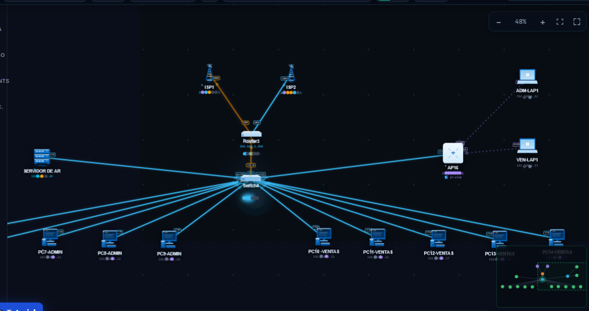
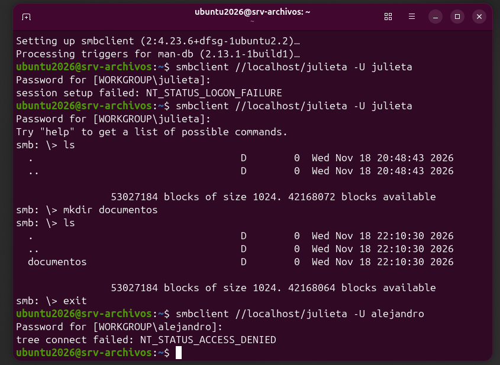
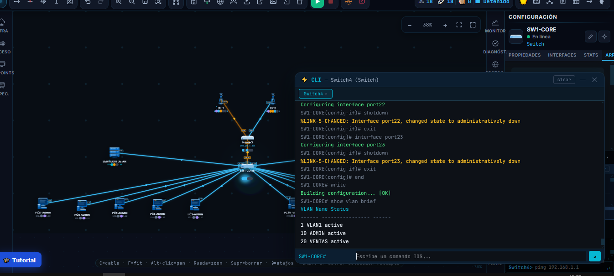
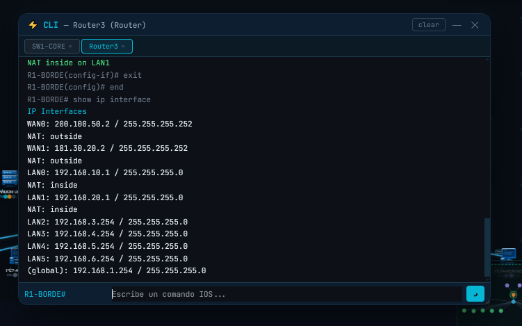
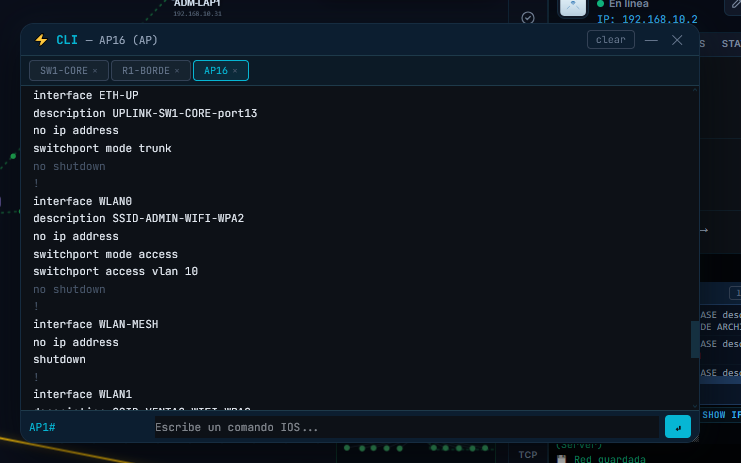
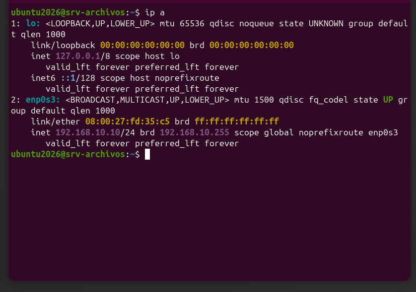
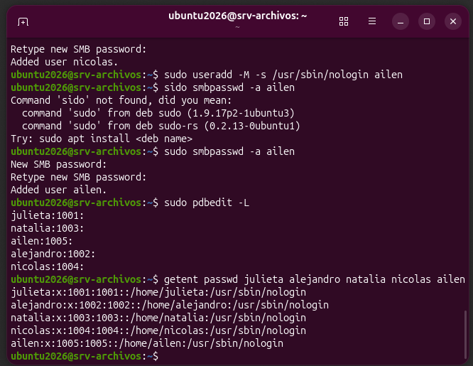
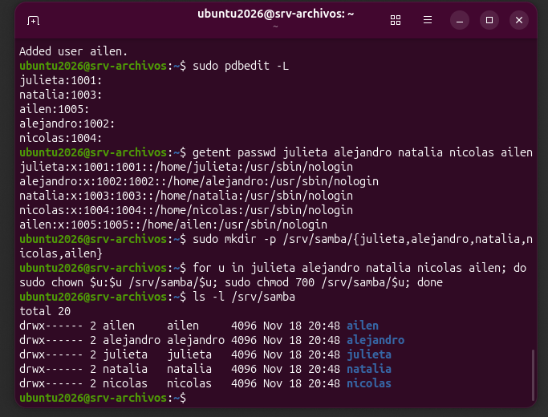

# Segmented Business Network — Dual ISP, VLANs & Samba File Server

Design and implementation of a segmented network for a small business, built in the **NET-EMU** network simulator, plus a **virtualized file server** (Ubuntu + Samba) with per-user access control.

> Academic project — *Práctica Profesionalizante II*, Higher Technical Degree in Networks & Cybersecurity (Instituto Superior Manuel Belgrano, Argentina). Approved by the instructor.



---

## 🎯 Objectives
- Router with **two ISPs** (primary + backup)
- Managed switch with **two VLANs** (Administration / Sales)
- Access point with **two SSIDs**, each mapped to one VLAN
- 12 hosts: 5 wired per VLAN + 1 wireless per SSID
- **Virtualized file server** with the same network config as the simulation: 5 users, each with an exclusive network folder

## 🗺️ Network design

| Network | VLAN | Subnet | Gateway |
|---|---|---|---|
| ADMIN | 10 | 192.168.10.0/24 | 192.168.10.1 |
| SALES | 20 | 192.168.20.0/24 | 192.168.20.1 |

| Device | IP | VLAN | Connection |
|---|---|---|---|
| File server | 192.168.10.10 | 10 | Switch port 12 |
| Access point (mgmt) | 192.168.10.2 | Trunk 10+20 | Switch port 13 |
| PC5–PC9 (Admin) | 192.168.10.11–15 | 10 | Switch ports 2–6 |
| PC10–PC14 (Sales) | 192.168.20.11–15 | 20 | Switch ports 7–11 |
| Admin laptop | 192.168.10.31 | 10 | Wi-Fi SSID ADMIN |
| Sales laptop | 192.168.20.31 | 20 | Wi-Fi SSID SALES |

## ⚙️ Implementation

**Edge router (R1-BORDE)**
- WAN0 → ISP1 (fiber, primary) · WAN1 → ISP2 (copper, backup) — media diversity
- WAN backup mode (failover) with default routes to both ISPs
- NAT overload (PAT) + ACL
- One LAN port per VLAN; unused LAN ports shut down

**Core switch (SW1-CORE)**
- VLAN 10 ADMIN / VLAN 20 SALES, access ports with PortFast
- Port 13 as **802.1Q trunk** (VLANs 10, 20) to the access point
- Unused ports (14–23) **administratively shut down**

**Access point**
- Two SSIDs with **WPA2**, each mapped to its VLAN
- Uplink as trunk; unused WLAN interfaces and mesh disabled

**File server (VirtualBox)**
- Ubuntu 26.04 LTS + Samba, static IP `192.168.10.10/24` on an internal network matching VLAN 10
- 5 users **without shell access** (`/usr/sbin/nologin`) — Samba access only
- One folder per user with `chmod 700` + `valid users` restriction per share
- Temporary NAT adapter used only for package installation, then disabled

## 🔐 Security measures
- Network segmentation by department (VLANs)
- Unused switch ports and router interfaces disabled
- WPA2 on both wireless networks
- Least privilege on the file server: no shell for users, private folders, per-share access lists
- Server isolated from the internet after setup

## 🧪 Validation
Access control tested with `smbclient`:
- `julieta` → own share: ✅ access granted
- `alejandro` → `julieta`'s share: ❌ `NT_STATUS_ACCESS_DENIED` (expected)



## 🐞 Troubleshooting: DHCP vs. static IPs
**Problem:** devices were set to DHCP mode, so the router assigned addresses dynamically and ignored the configured static IPs, causing an IP conflict with the access point.
**Solution:** all devices switched to static addressing in a controlled order.
**Lesson:** always exclude the static IP range from the DHCP pool.

## 🚀 Possible improvements
- Enforce `server min protocol = SMB3` on Samba (disable legacy NTLM/SMB1)
- WPA3 or WPA2-Enterprise (802.1X) for wireless access
- Inter-VLAN ACLs to restrict traffic between departments
- Centralized monitoring (e.g. Zabbix)

## 📸 Evidence

| Switch VLANs | Router interfaces & NAT | Access point SSIDs |
|---|---|---|
|  |  |  |

| Server network | Samba users (no shell) | Folder permissions |
|---|---|---|
|  |  |  |

More screenshots in the [`screenshots/`](screenshots) folder.

## 📂 Repository structure
```
topology/      NET-EMU project file (JSON)
server/        Samba configuration
screenshots/   Simulation and server evidence
```

## ▶️ How to open the topology
1. Go to [NET-EMU](https://network-emulator.io/simulador/index.html)
2. Import `topology/netemu-topology.json`

---
👩‍💻 **Julieta Cuenca** · [LinkedIn](https://linkedin.com/in/julieta-cuenca) · [Website](https://holasoyjuli.com.ar)
